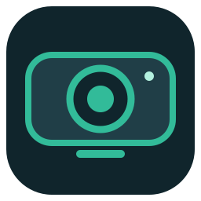
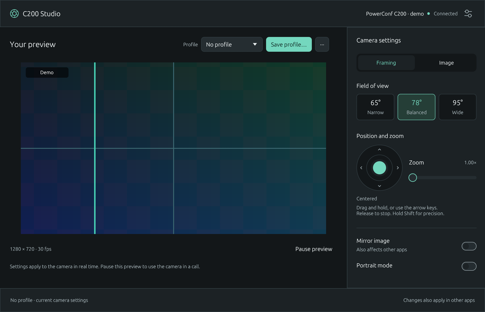
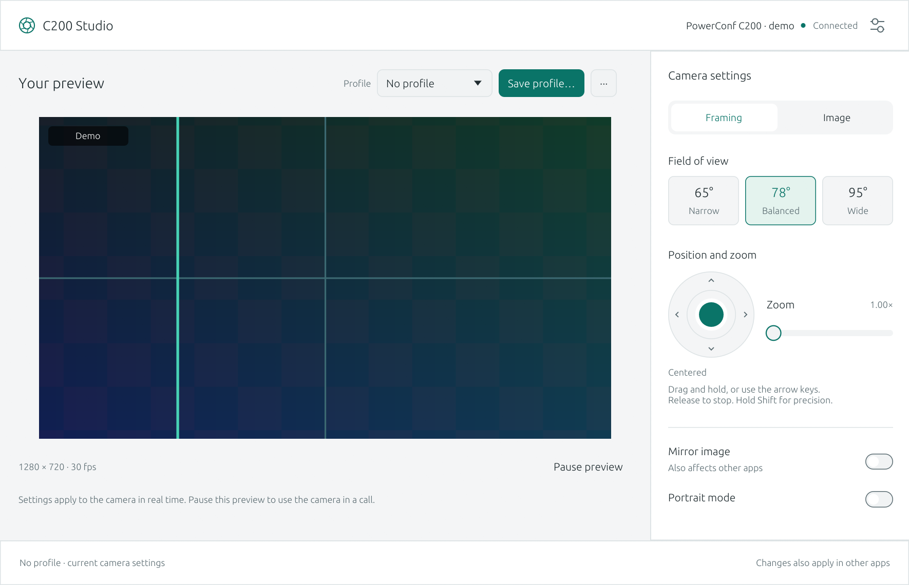

<div align="center">
  
  <h1>C200 Studio</h1>
  <p><strong>Your PowerConf C200, at home on Linux.</strong></p>
  <p>Live preview, precise framing, and camera profiles in a Rust desktop app.</p>
</div>

[](https://github.com/FilipeJrd/c200-studio/actions/workflows/ci.yml)
[](https://github.com/FilipeJrd/c200-studio/actions/workflows/appimage.yml)
[MIT licensed](LICENSE)

C200 Studio brings camera controls to Linux for the **Anker PowerConf C200**.
Frame your shot with a joystick, adjust the image while watching a live preview,
and save profiles for your next call.

[Get started](#get-started) · [User guide](docs/user-guide.md) · [Release guide](docs/releases.md) · [Contributing](CONTRIBUTING.md)



*The actual app in demo mode, using a simulated camera. Shown in English.*

<details>
<summary>View the light theme</summary>



</details>

## Built around your camera

| | What you can do |
| --- | --- |
| **Frame your shot** | Choose 65°, 78°, or 95° field of view. Adjust pan and tilt with a two-axis joystick, set zoom, and mirror the image. |
| **Tune your image** | Adjust brightness, focus, white balance, HDR, and more. Manual settings appear alongside their automatic modes. |
| **Keep your setup** | Save named profiles for each camera and reapply them at startup or reconnection while the app is running. |
| **See what changes** | Use the live MJPEG/YUYV preview with selectable resolution and frame rate. Pause it to release capture for a call. |
| **Feel at home** | Light and dark themes, HiDPI rendering, keyboard controls, and automatic camera discovery. |

Changes are applied to the camera and confirmed by readback. Available controls
and their ranges come from the driver; support can vary by firmware.

## Get started

### Download an AppImage

The current source version is **0.2.0**. Until the first versioned release,
packages are available as development builds:

1. Open the [AppImage workflow](https://github.com/FilipeJrd/c200-studio/actions/workflows/appimage.yml)
   and choose a successful run on **main**.
2. Download **C200-Studio-linux-x86_64** from the run's **Artifacts** section
   and extract the archive. GitHub requires
   [sign-in to download workflow artifacts](https://docs.github.com/en/actions/how-tos/manage-workflow-runs/download-workflow-artifacts).
3. Verify the checksum and launch:

   ```sh
   sha256sum --check C200-Studio-x86_64.AppImage.sha256
   chmod +x C200-Studio-x86_64.AppImage
   ./C200-Studio-x86_64.AppImage
   ```

AppImages target **Linux x86_64**, built on **Ubuntu 22.04**. Development artifacts
are kept for **14 days**. See the [release guide](docs/releases.md) for downloads
with GitHub CLI and the current release process.

<details>
<summary>Running without FUSE</summary>

```sh
./C200-Studio-x86_64.AppImage --appimage-extract-and-run
```

</details>

### Try it without a camera

```sh
./C200-Studio-x86_64.AppImage --demo
```

Demo mode uses a simulated camera and temporary settings, so you can explore
the interface before connecting hardware.

### Your first session

1. Connect a PowerConf C200; the app detects it automatically.
2. Use **Framing** for field of view, joystick, zoom, and mirroring.
3. Open **Image** to adjust brightness, focus, and color.
4. Choose **Save profile…** to keep your settings for this camera.
5. Choose **Pause preview** before using the camera in a video call.

Profiles are stored locally. Selecting a profile applies it; later changes
are saved only when you choose **Save**. See the [user guide](docs/user-guide.md)
for configuration paths, technical controls, and troubleshooting.

## Build from source

Clone the repository and install the Rust toolchain pinned in
[`rust-toolchain.toml`](rust-toolchain.toml). With rustup, entering the project
and running Cargo installs the specified toolchain and components automatically.

```sh
git clone https://github.com/FilipeJrd/c200-studio.git
cd c200-studio
```

<details>
<summary>Ubuntu 22.04 / 24.04 dependencies</summary>

```sh
sudo apt-get update
sudo apt-get install build-essential clang libclang-dev pkg-config libx11-dev libxi-dev libxrandr-dev libxcursor-dev libxkbcommon-dev libxkbcommon-x11-dev libwayland-dev libgl1-mesa-dev libegl1-mesa-dev libudev-dev libdbus-1-dev
```

Install Rust separately before building.

</details>

<details>
<summary>Arch / CachyOS dependencies</summary>

```sh
sudo pacman -S --needed rust clang pkgconf linux-api-headers libxkbcommon libxkbcommon-x11 wayland libx11 libxi libxrandr libxcursor libglvnd
```

When using distribution packages, make sure the installed Rust version matches
the pinned toolchain, including rustfmt and Clippy.

</details>

```sh
cargo run --release --locked -p c200-app
# Or explore without hardware:
cargo run --release --locked -p c200-app -- --demo
```

Built with **Rust**, **egui/eframe**, and direct **V4L2** access. Runtime graphics
use the system's OpenGL and Wayland/X11 libraries.

## Documentation and development

| Guide | Contents |
| --- | --- |
| [User guide](docs/user-guide.md) | Framing, calls, profiles, diagnostics, and troubleshooting. |
| [Releases](docs/releases.md) | Development downloads, manual releases, and planned automation. |
| [Contributing](CONTRIBUTING.md) | Build checks, hardware testing, and pull request guidelines. |
| [Validation](VALIDATION.md) | Tested environments, real-camera checks, and firmware limitations. |
| [Interface design](docs/interface-benchmark.md) | The reference apps and decisions behind the Studio layout. |

The workspace has three crates: `c200-core` for the domain model and profiles,
`c200-linux` for device controls and capture, and `c200-app` for the GUI.
Pull requests run formatting, workflow validation, Clippy, and tests on Ubuntu
22.04/24.04, plus AppImage packaging and GUI smoke tests.

To build a portable AppImage on Ubuntu 22.04 using Docker:

```sh
bash scripts/portable-appimage.sh
```

For packaging directly on the build host, see [CONTRIBUTING.md](CONTRIBUTING.md#packaging).

## License and acknowledgements

C200 Studio is an independent, unofficial project and is not affiliated with
Anker. It is designed for the PowerConf C200 (`291a:3369`); other Anker devices
are outside the current supported scope.

Released under the [MIT license](LICENSE). The vendor protocol was ported from
[Eran Sandler's anker-powerconf-c200-linux-tools](https://github.com/erans/anker-powerconf-c200-linux-tools).
See [third-party notices](THIRD_PARTY_NOTICES.md) for the source revision,
attribution, and dependency license information.
